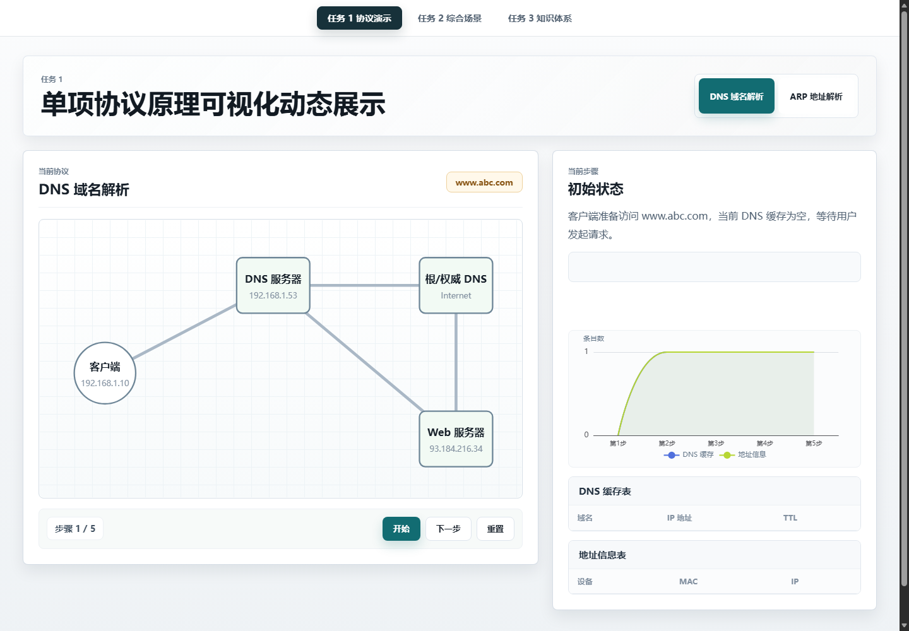
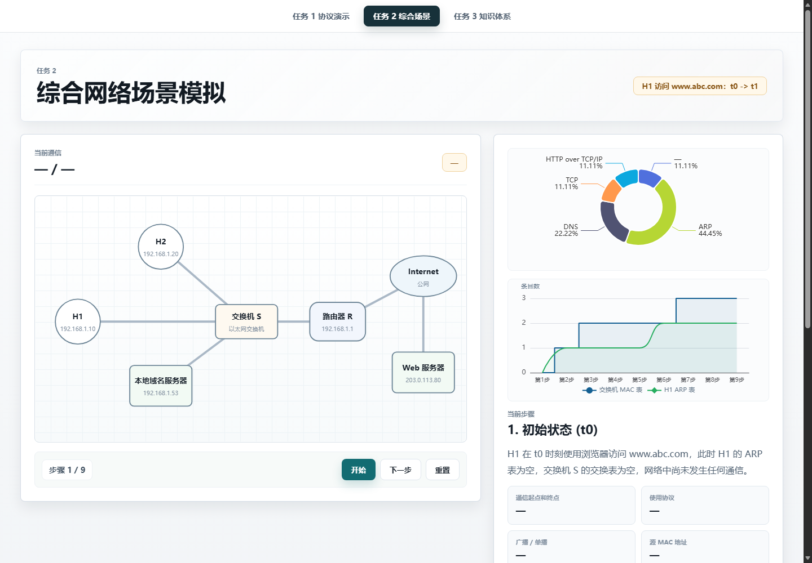
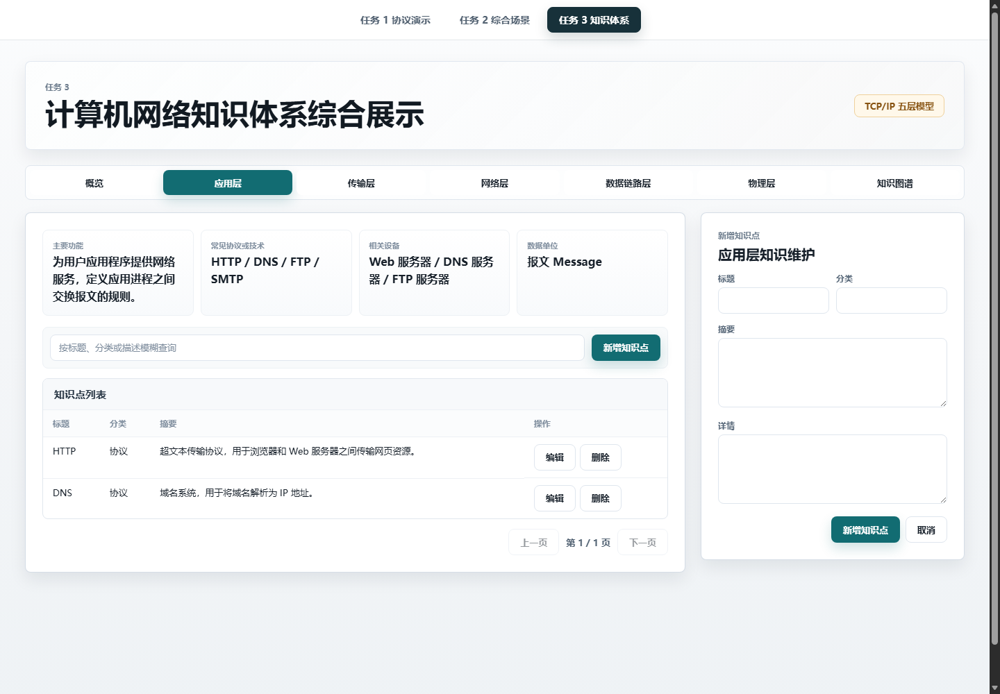

# 计算机网络知识体系交互式展示系统

本项目是《网络实习》课程项目，围绕计算机网络核心知识体系设计并实现一个交互式学习系统。系统包含单项协议原理可视化、综合网络场景模拟、TCP/IP 五层知识体系展示与知识点维护三部分，帮助用户通过拓扑动画、步骤切换、状态表变化和知识图谱理解网络协议运行过程。

## 项目简介

系统面向计算机网络课程实习场景，完成指导书要求的三类功能：

- 单项协议原理可视化动态展示：实现 DNS 域名解析和 ARP 地址解析两个协议演示。
- 综合网络场景模拟：模拟 H1 访问 `www.abc.com` 从 `t0` 到 `t1` 的完整通信过程。
- 计算机网络知识体系展示：围绕 TCP/IP 五层模型展示知识点，并支持新增、编辑、删除、模糊查询、分页和知识图谱查看。

前端支持在后端未启动时使用 `localStorage` 兜底展示知识体系数据；后端可连接 MySQL，实现知识点数据持久化。

## 技术栈

### 前端

- Vue 3
- Vue Router 4
- Vite
- ECharts / vue-echarts
- SVG 拓扑动画
- CSS Grid / Flex 响应式布局
- localStorage 本地兜底存储

### 后端

- Node.js
- Express
- MySQL
- mysql2
- dotenv
- cors

### 文档与构建

- npm
- Vite build
- MySQL 初始化 SQL
- Word / PDF 实习文档

## 项目结构

```text
.
├─ src/
│  ├─ App.vue
│  ├─ main.js
│  ├─ router/
│  ├─ views/
│  │  ├─ ProtocolDemo.vue
│  │  ├─ NetworkScenarioDemo.vue
│  │  └─ KnowledgeSystem.vue
│  ├─ components/
│  │  ├─ TopologyCanvas.vue
│  │  ├─ ScenarioTopology.vue
│  │  ├─ StateDisplay.vue
│  │  ├─ ScenarioStepDisplay.vue
│  │  ├─ KnowledgeOverview.vue
│  │  ├─ KnowledgeLayerPanel.vue
│  │  ├─ KnowledgePointEditor.vue
│  │  └─ KnowledgeGraphView.vue
│  ├─ composables/
│  │  ├─ useProtocolSimulator.js
│  │  ├─ useNetworkScenarioSimulator.js
│  │  └─ useKnowledgeSystem.js
│  ├─ services/
│  │  └─ knowledgeApi.js
│  └─ assets/
│     └─ styles.css
├─ backend/
│  ├─ src/
│  │  ├─ app.js
│  │  ├─ db.js
│  │  ├─ routes/
│  │  ├─ controllers/
│  │  └─ models/
│  ├─ sql/
│  │  └─ init.sql
│  ├─ .env.example
│  └─ package.json
├─ docs/
│  └─ screenshots/
├─ api-doc.html
├─ vite.config.js
├─ package.json
└─ README.md
```

## 环境配置

### 基础环境

建议环境：

- Node.js 18 或更高版本
- npm 9 或更高版本
- MySQL 8.x
- 现代浏览器：Microsoft Edge / Chrome

### 前端配置

前端依赖在项目根目录安装：

```bash
npm install
```

当前 Vite 代理配置位于 `vite.config.js`：

```js
server: {
  proxy: {
    '/api': 'http://localhost:8080'
  }
}
```

如果需要让前端 CRUD 请求直接走后端接口，建议将后端端口配置为 `8080`；如果后端使用默认 `3000`，则需要把 Vite 代理改为 `http://localhost:3000`。

### 后端配置

进入后端目录：

```bash
cd backend
npm install
```

复制环境变量文件：

```bash
copy .env.example .env
```

按本机 MySQL 配置修改 `.env`：

```env
PORT=8080
DB_HOST=127.0.0.1
DB_PORT=3306
DB_USER=root
DB_PASSWORD=your_password
DB_NAME=network_internship
CORS_ORIGIN=http://localhost:5173
```

说明：`.env.example` 中默认端口为 `3000`，但当前前端代理默认指向 `8080`，因此推荐把 `PORT` 改为 `8080`。

### 数据库初始化

在 MySQL 中执行初始化脚本：

```bash
mysql -u root -p < backend/sql/init.sql
```

该脚本会创建并初始化 `network_internship` 数据库及 TCP/IP 五层知识体系相关表。

## 运行方式

### 只运行前端

项目支持前端独立运行，知识体系数据会使用 `localStorage` 兜底：

```bash
npm run dev
```

浏览器访问：

```text
http://localhost:5173
```

如果 5173 端口被占用，Vite 会自动切换到其他端口，终端会显示实际访问地址。

### 前后端一起运行

先启动后端：

```bash
cd backend
npm run start
```

再回到项目根目录启动前端：

```bash
npm run dev
```

前端页面通过 `/api/knowledge/...` 调用后端知识体系接口。

### 生产构建

```bash
npm run build
```

构建结果输出到 `dist/` 目录。

## 主要功能

### 1. 单项协议原理可视化动态展示

已实现协议：

- DNS 域名解析
- ARP 地址解析

功能点：

- 网络拓扑图展示
- 开始、下一步、重置控制
- 报文沿路径动态传递
- 当前节点和链路高亮
- 步骤说明、报文字段、解析结果展示
- DNS 缓存表、ARP 缓存表、交换机 MAC 表动态变化

### 2. 综合网络场景模拟

模拟题目场景：

```text
H1 使用浏览器访问 www.abc.com
t0：H1 的 ARP 表为空，交换机 S 的交换表为空
t1：交换机 S 第一次收到封装 HTTP 请求报文的以太网帧
```

展示内容：

- 当前步骤编号和名称
- 起点、终点和通信目的
- 协议类型：ARP、DNS、TCP、HTTP
- 广播 / 单播类型
- 源 MAC、目的 MAC
- 源 IP、目的 IP
- 拓扑传输路径
- 交换机 S 的处理行为
- H1 的 ARP 表变化
- 交换机 S 的交换表变化
- 最终状态和结论

### 3. TCP/IP 五层知识体系展示与交互学习

包含层次：

- 应用层
- 传输层
- 网络层
- 数据链路层
- 物理层
- 知识图谱

功能点：

- TCP/IP 五层模型概览
- 各层主要功能、常见协议、相关设备、数据单位展示
- 知识点列表展示
- 分页
- 模糊查询
- 新增知识点
- 编辑知识点
- 删除知识点
- ECharts 知识图谱
- 点击节点查看详情

## 后端接口

接口文档位于根目录：

```text
api-doc.html
```

可直接双击用浏览器打开。

主要接口：

| 方法 | 路径 | 说明 |
| --- | --- | --- |
| GET | `/api/health` | 健康检查 |
| GET | `/api/knowledge/layers` | 获取五层模型及知识点 |
| POST | `/api/knowledge/layers/:layerId/points` | 新增知识点 |
| PUT | `/api/knowledge/layers/:layerId/points/:pointId` | 修改知识点 |
| DELETE | `/api/knowledge/layers/:layerId/points/:pointId` | 删除知识点 |

`layerId` 可取：

```text
application
transport
network
datalink
physical
```

## 演示截图

### 单项协议原理可视化



### 综合网络场景模拟



### TCP/IP 知识体系展示



## 提交材料说明

项目中包含以下实习相关材料：

- 源代码：`src/`、`backend/`
- 数据库脚本：`backend/sql/init.sql`
- 接口文档：`api-doc.html`
- 设计方案 PDF：`计算机网络实习项目设计方案文档.pdf`
- 实习报告 DOCX/PDF：`2023011577-梁名修-网络实习报告.docx`、`2023011577-梁名修-网络实习报告.pdf`

## 备注

- 前端知识体系模块具备 `localStorage` 兜底能力，后端未启动时也能展示默认数据。
- 如需验证数据库持久化，请先启动 MySQL、执行初始化 SQL，并确保后端端口与 Vite 代理一致。
- 若 Windows PowerShell 阻止运行 `npm.ps1`，可使用 `npm.cmd run dev` 或 `npm.cmd run build`。
